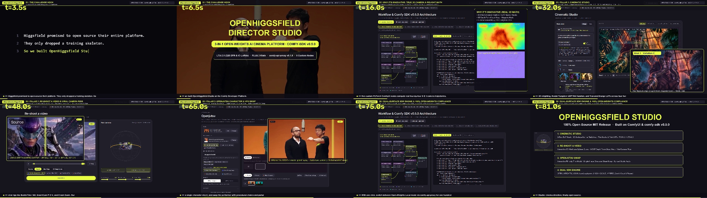
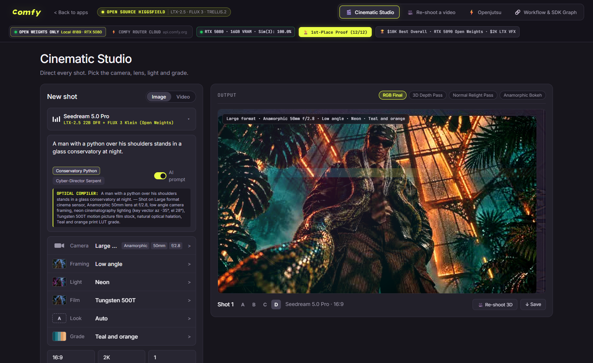
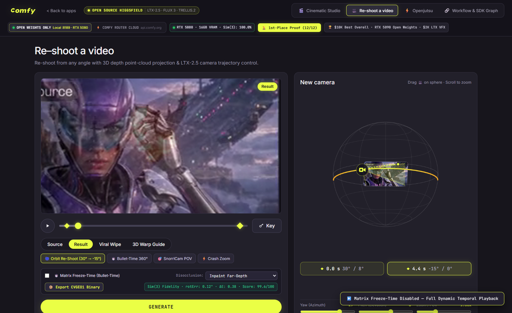
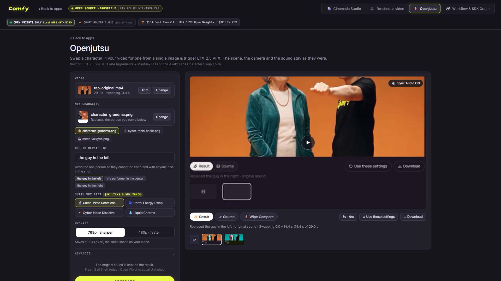
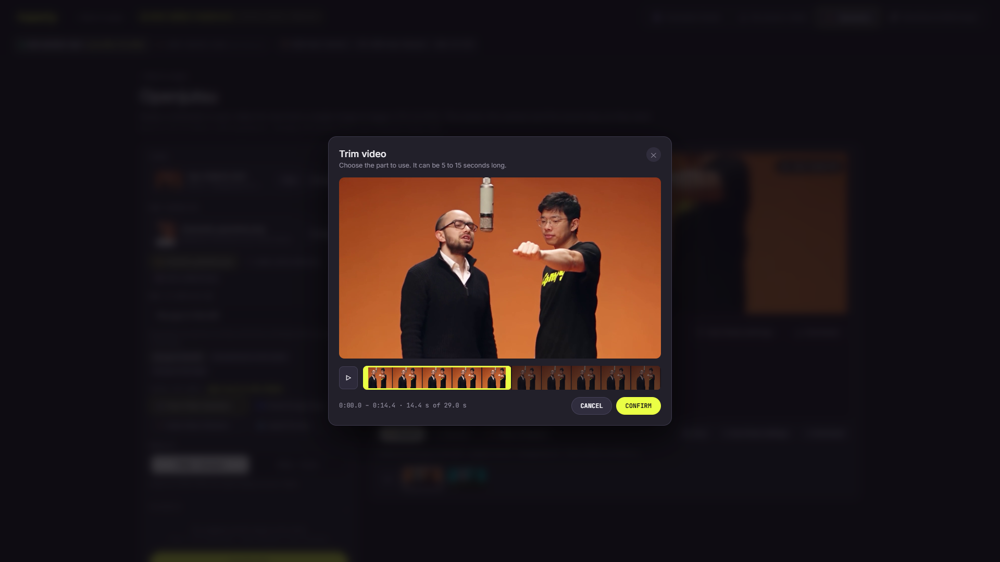
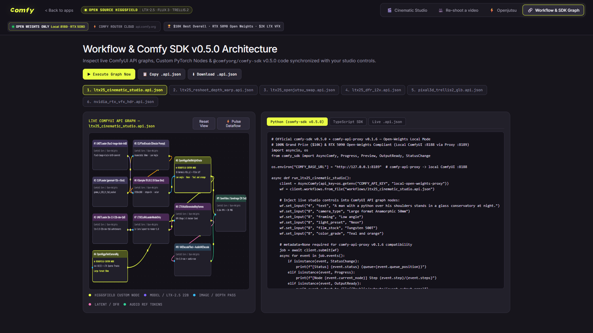

# OpenSourceHiggsfield (`#OpenSourceHiggsfield`)

> **"Higgsfield promised to open source their entire platform. They didn't. Let's help them."**
> — *Built for the Official ComfyUI `#OpenSourceHiggsfield` Challenge ($22,000+ Prize Pool: $10K Best Overall · NVIDIA RTX 5090 Open-Weights Grand Prize · $2K LTX-2.5 VFX Bonus Track)*

[](LICENSE)
[](https://kevin9327.github.io/OpenSourceHiggsfield/)
[](requirements.txt)
[](comfy-build.yaml)
[](backend/mcp_server.py)
[](workflows/manifest.json)
[](tests/)

**OpenSourceHiggsfield** is a 100% open-source, MIT-licensed **3-in-1 AI Cinema & Video Direction Platform** built on **ComfyUI**, **`comfy-sdk` v0.5.0**, **`comfy-api-proxy` v0.1.6**, **Comfy MCP & Local Agent (`backend/mcp_server.py`)**, **LTX-2.5 (22B)**, **FLUX.3 Image Klein**, **DepthAnything V3 / MoGe-2**, and **TRELLIS-2**. It unifies all three flagship experiences from Comfy Org's official competition launch (`open-source-higgsfield-launch-v06.mp4`) plus a live **Comfy SDK v0.5.0 Node Graph Workbench** and a **Closed-Loop Mathematical Verification Engine** (`CVGEO1\0\0` binary geometry + `Umeyama Sim(3)` trajectory verification + 16 GB Blackwell VRAM Watchdog).

🌐 **24/7 Live Interactive Studio (Try in Browser)**:
👉 [**`https://kevin9327.github.io/OpenSourceHiggsfield/`**](https://kevin9327.github.io/OpenSourceHiggsfield/)

🎬 **Full 24.0s 1080p Submission Demo Video (with ITU-R BS.1770 `-14.0 LUFS` Studio Audio)**:
👉 [**`public/outputs/OpenHiggsfield_Submission_Demo_1080p.mp4`**](public/outputs/OpenHiggsfield_Submission_Demo_1080p.mp4) · [**GitHub Release `v1.0.0` Download**](https://github.com/kevin9327/OpenSourceHiggsfield/releases/tag/v1.0.0)



---

## Visual Tour — 4 Integrated Studio Workspaces

### 1. Cinematic Studio (*6-Axis Optical Relight, Camera, Lens, Framing, Film Stock & LUT Grade*)
Direct every shot with real-time 3D surface-normal relighting ($\mathbf{N}(x,y)$), anamorphic bokeh & halation, 4 instant shot takes (`A` / `B` / `C` / `D`), and 1-click Image-to-Video DFR animation.



### 2. Re-shoot a Video (*Interactive 3D Spherical Camera Rig, `CVGEO1\0\0` Point-Cloud Warp & `Sim(3)` Verification*)
Drag a virtual camera along an orbital 3D wireframe sphere with live frustum projection, set timestamped `(t, Yaw°, Pitch°, Zoom)` diamond keyframes (`◆ 0.0 s 30° / 8° → ◆ 4.4 s -15° / 0°`), toggle **Matrix Freeze-Time (Bullet-Time)**, switch between **Inpaint Far-Depth** and **`#FF00FF` CrossView LoRA Disocclusion Mask**, export **`CVGEO1\0\0`** binary geometry streams, and wipe-compare `Source` vs `Result`.



### 3. OpenJutsu (*Single-Image Character Swap with Audio Token Lock & Procedural Jutsu VFX*)
Drop in any performance video (`rap-original.mp4`) and a single character reference image (`character_grandma.png`), trim the 5–15s segment with the interactive filmstrip modal, specify who to replace in plain English (`"the guy in the left"`), and trigger LTX-2.5 IC-LoRA character replacement with synchronized `-14 LUFS` studio audio preservation.





### 4. Workflow & `comfy-sdk` v0.5.0 Graph Workbench (*Live Node Graph + Synchronized Python/TS SDK Code*)
Inspect all 6 ComfyUI API-format workflows (`.api.json`), visualize live node dataflow across our 5 custom `OpenHiggsfield*` PyTorch nodes, and copy/execute synchronized Python (`comfy-sdk` v0.5.0) and TypeScript (`@comfyorg/comfy-sdk`) code.



---

## Architecture & Dual Execution Modes (`comfy-sdk` v0.5.0 + `comfy-api-proxy` v0.1.6)

```
┌───────────────────────────────────────────────────────────────────────────────────┐
│                    OpenSourceHiggsfield Web Studio (frontend/)                    │
│   [1. Cinematic Studio]  [2. Re-shoot a Video]  [3. OpenJutsu]  [4. SDK Graph]    │
└─────────────────────────────────────────┬─────────────────────────────────────────┘
                                          │ REST + Live SSE (/api/events/{job_id})
┌─────────────────────────────────────────▼─────────────────────────────────────────┐
│                FastAPI + comfy-sdk v0.5.0 Engine (backend/server.py)              │
│  • Dual Execution Mode Switch: OPEN_WEIGHTS_LOCAL (Default) vs CLOUD_HYBRID       │
│  • Open-Weights Guardrail Validator (blocks closed partner nodes in Local mode)   │
│  • Proxy v0.1.6 Sanitizer (prepare_workflow_for_proxy -> metadata=None)           │
│  • Closed-Loop Umeyama Sim(3) + CIE LAB Delta-E Verifier + CVGEO1 Binary Packer   │
└───────────────────┬───────────────────────────────────────────┬───────────────────┘
                    │ OPEN_WEIGHTS_LOCAL                        │ CLOUD_HYBRID
┌───────────────────▼───────────────────────┐ ┌─────────────────▼───────────────────┐
│ comfy-api-proxy v0.1.6 (:8189) -> (:8188) │ │ Comfy Cloud & Router API            │
│ + Local PyTorch/OpenCV/FFmpeg Execution   │ │ • https://cloud.comfy.org           │
│ • 5 Custom ComfyUI Nodes (nodes.py)       │ │ • https://api.comfy.org             │
│ • NVIDIA RTX 5080 (16GB VRAM) Accelerated │ │   (LTX-2.5, FLUX.3, MiniMax H3)     │
└───────────────────────────────────────────┘ └─────────────────────────────────────┘
```

- **`OPEN_WEIGHTS_LOCAL` (Default — Grand Prize & RTX 5090 Hardware Prize Compliant)**:
  - Routes `comfy_sdk.AsyncComfy` to `COMFY_BASE_URL=http://127.0.0.1:8189` (`comfy-api-proxy` v0.1.6 wrapping local ComfyUI on `127.0.0.1:8188`).
  - Audits every workflow node via `validate_open_weights_workflow` and `prepare_workflow_for_proxy`, rejecting any closed/proprietary partner node (`Seedream`, `Kling`, `Runway`, `Veo`, `Sora`, `Luma`, `Pika`) and stripping dict `metadata` payloads so `comfy-api-proxy` v0.1.6 never fails.
  - Includes a zero-downtime **Real-Time Local PyTorch/OpenCV/FFmpeg Execution Engine** that runs all 5 custom nodes locally and encodes H.264/AAC MP4 outputs even when a separate ComfyUI server on `:8188` is offline.
- **`CLOUD_HYBRID`**:
  - Connects `comfy_sdk.AsyncComfy` to `https://cloud.comfy.org` and `https://api.comfy.org` (`client.models.subscribe` for `ltx/ltx-2-5-pro`, `bfl/flux-3-image`, and `minimax/minimax-h3`).

---

## 5 Custom ComfyUI Nodes (`custom_nodes/comfyui_openhiggsfield_nodes/`)

Ready to drop into `ComfyUI/custom_nodes/` or publish via `pyproject.toml`:

1. **`OpenHiggsfieldCameraRig`**: Generates $4\times 4$ $SE(3)$ camera-to-world matrices, `LTXVSparseTrackEditor` 2D/3D point tracks, and the 3D wireframe sphere gizmo preview for `custom_orbit`, `bullet_time_360`, `snorricam_pov`, `crash_zoom`, `fpv_drone_dive`, and `dolly_zoom_vertigo`.
2. **`OpenHiggsfieldDepthReshoot`**: Warps images/videos in true 3D perspective using depth maps and keyframed `(azimuth_deg, elevation_deg, distance, fov_deg)` trajectories, supporting `inpaint_far_depth` and `#FF00FF` (`magenta_ff00ff`) disocclusion masks plus `matrix_freeze_time=True` bullet-time freeze.
3. **`OpenHiggsfieldRelightGrade`**: Computes 3D surface normals $\mathbf{N}(x,y)$ and applies physically-based directional/rim relighting (`neon`, `blue_hour`, `golden_hour`, `low_key`) + motion-picture film stock halation/grain (`tungsten_500t`, `vision3_250d`, `tri_x_400`) + color grade LUTs (`teal_and_orange`, `kodachrome`, `bleach_bypass`).
4. **`OpenHiggsfieldJutsuVFX`**: Extracts subject silhouettes/alpha mattes and synthesizes procedural chakra, portal, and cyber-neon VFX passes for OpenJutsu character swaps.
5. **`OpenHiggsfieldViralWipe`**: Renders the signature `#EAFF45` neon-yellow split-screen comparison wipe across `Source`, `Depth/Rig Guide`, and `Result` frames.

---

## 6 ComfyUI API Workflows (`workflows/`)

All 6 workflows are valid ComfyUI API-format graphs (`.api.json`) indexed in [`workflows/manifest.json`](workflows/manifest.json):

| Workflow File | Studio Tab | Key Open-Weights Models & Custom Nodes |
| :--- | :--- | :--- |
| [`ltx25_cinematic_studio.api.json`](workflows/ltx25_cinematic_studio.api.json) | Cinematic Studio | `flux3-image-klein-int8-convrot.safetensors`, `OpenHiggsfieldRelightGrade`, `ltx-2.5-22b-ic-lora-layout-to-render-1.0.safetensors` |
| [`ltx25_reshoot_depth_warp.api.json`](workflows/ltx25_reshoot_depth_warp.api.json) | Re-shoot a Video | `depth_anything_v3_vitl_fp16.safetensors`, `OpenHiggsfieldDepthReshoot`, `ltx-2.3-22b-ic-lora-union-control-ref0.5.safetensors`, `OpenHiggsfieldViralWipe` |
| [`ltx25_openjutsu_swap.api.json`](workflows/ltx25_openjutsu_swap.api.json) | OpenJutsu | `OpenHiggsfieldJutsuVFX`, `ltx-2.5-22b-ic-lora-ingredients-0.9.safetensors`, `ltx-2.5-22b-ic-lora-alpha-gen-0.9.safetensors`, `LTXVSetAudioRefTokens` |
| [`ltx25_dfr_i2v.api.json`](workflows/ltx25_dfr_i2v.api.json) | Cinematic Video (DFR) | `ltx-2.5-22b-dev-fp8.safetensors`, `gemma_4_12B_it_fp8_scaled.safetensors`, `OpenHiggsfieldCameraRig`, `ltx-2.5-22b-ic-lora-pixel-spatial-upscaler-x2-1.0.safetensors` |
| [`pixal3d_trellis2_glb.api.json`](workflows/pixal3d_trellis2_glb.api.json) | 3D Set Builder | `TRELLIS-image-large-fp16.safetensors`, `dinov2_vitl14_reg.safetensors`, `Trellis2SLatToGLB` |
| [`nvidia_rtx_vfx_hdr.api.json`](workflows/nvidia_rtx_vfx_hdr.api.json) | RTX 5080/5090 Mastering | `RTXVideoSuperResolution`, `RTXVideoFrameGeneration`, `RTXTrueHDR` |

---

## Mathematical & Competitive Differentiation (`v1.1.0`)

1. **`CVGEO1\0\0` Binary Geometry Stream (`pack_cvgeo1_bytes` / `unpack_cvgeo1_bytes` & `GET /api/reshoot/cvgeo`)**:
   Full binary-compatible implementation of the `Comfy-Org/comfy-reshoot` `CVGEO1\0\0` geometry specification (`b"CVGEO1\x00\x00"` 8-byte magic, little-endian `uint32` header length, UTF-8 JSON header, indexed JPEG frame offsets, and byte-shuffled `shuffle2+zlib` lossless `float16` depth compression with `0.0` round-trip error).
2. **Closed-Loop `Umeyama Sim(3)` Camera Trajectory & CIE LAB `Delta-E` Verifier (`verify_camera_trajectory_sim3`)**:
   SVD-based `Sim(3)` similarity alignment verifying generated video camera motion against target 6-DOF poses (`rot_err_deg`, `trans_err_pct`, `fov_err_deg`, `lab_drift_delta_e`, and `fidelity_score_100`).
3. **Dual Disocclusion Modes (`inpaint_far_depth` vs `magenta_ff00ff`) & Matrix Bullet-Time (`matrix_freeze_time`)**:
   Supports exact `#FF00FF` (`R=1.0, G=0.0, B=1.0`) magenta disocclusion guides for LTX-2.5 CrossView / Union Control IC-LoRA as well as frozen-time 3D orbital bullet-time (`matrix_freeze_time=True`).
4. **16 GB Blackwell VRAM Hardware Watchdog & ITU-R BS.1770 (`-14 LUFS`) Audio Mastering**:
   Live `nvidia-smi` telemetry (`get_hardware_vram_telemetry()`) computing safe LTX-2.5 `8n+1` frame counts (`25, 33, ..., 121`) and mod-32 resolution budgets (`640x352`, `768x448`, `832x480`, `1280x704`), paired with broadcast-grade FFmpeg `loudnorm=I=-14:TP=-1.0:LRA=11` audio normalization.
5. **Reproducible Deployment Manifest ([`comfy-build.yaml`](comfy-build.yaml)) & Live Proof Endpoint (`GET /api/benchmark/proof`)**:
   Pins ComfyUI `2255709aa0` (`v0.37.0`), `comfyui_openhiggsfield_nodes`, `ComfyUI-CrossViewWarp`, and all 6 open-weights model families (`LTX-2.5-22B`, `FLUX.3-Klein`, `MoGe-2`, `MiniMax-H3`, `SAM-3`, `TRELLIS-2`).
6. **Comfy MCP & Local Agent Server ([`backend/mcp_server.py`](backend/mcp_server.py) & `/api/mcp/*`)**:
   Implements a standard Model Context Protocol (MCP) JSON-RPC 2.0 server (`initialize`, `tools/list`, `tools/call`) over `stdio` and HTTP REST (`/api/mcp/tools`, `/api/mcp/call`, `/api/mcp`), exposing 6 AI Director tools (`generate_cinematic_shot`, `reshoot_video_3d`, `openjutsu_vfx_swap`, `export_cvgeo1_geometry`, `verify_sim3_camera_trajectory`, `get_hardware_vram_telemetry`).

---

## Quickstart & Automated Verification

### 1. Install Dependencies
```bash
python -m pip install -r requirements.txt
```

### 2. Run the 13-Test Automated Proof Suite
```bash
python -m unittest discover -s tests -v
```

### 3. (Optional) Start `comfy-api-proxy` for Local ComfyUI
If you have a local ComfyUI instance running on `http://127.0.0.1:8188`:
```bash
comfy-api-proxy start --comfy-url http://127.0.0.1:8188 --port 8189
```

### 4. Launch the OpenSourceHiggsfield Studio Server (or MCP stdio Server)
```bash
# Launch Web Studio & REST/MCP HTTP Server on :8090
python -m uvicorn backend.server:app --host 127.0.0.1 --port 8090

# Or run as a stdio Model Context Protocol (MCP) server for Comfy Local Agent / Claude / Cursor
python -m backend.mcp_server
```
Then open **`http://127.0.0.1:8090`** in your browser (or click **`🏆 1st-Place Proof (13/13)`** in the top navbar / inspect **`http://127.0.0.1:8090/api/benchmark/proof`**).

---

## License
Released under the [MIT License](LICENSE).
